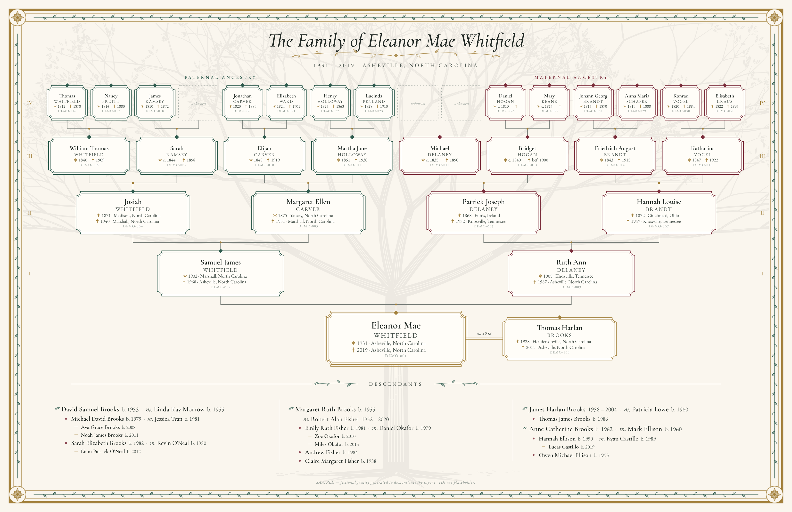

# Printable family tree from FamilySearch data

`familytree.py` turns a GEDCOM export of FamilySearch Family Tree data into a print-ready family tree centred on one person:

- **Ancestors** (up to 4 generations back) as a pedigree above the focus person. The paternal line is on the left in sage, the maternal line on the right in clay. Parents who haven't been identified yet appear as dashed "not yet identified" boxes, so research gaps are easy to spot.
- **Descendants** (up to 3 generations forward) as an indented outline below. Each line shows the person, their spouse and their dates, and the outline flows into balanced columns.
- **Decoration**: line-art botanical corners, a laurel flourish, a double-rule border, Cormorant Garamond and EB Garamond type.
- **Verification**: each card shows the person's FamilySearch ID. The script also runs consistency checks and prints the results: impossible parent ages, a parent who died before the child's birth, sex/position mismatches, a person appearing twice in the pedigree, and ancestors with no ID.



*(The sample is a fictional family. Its IDs are placeholders.)*

## Getting the data out of FamilySearch

**Option A (official):** FamilySearch → [Download your family tree](https://familysearch.org/innovate/export) gives a GEDCOM 7 file (`.ged` or `.gdz`, both accepted) of up to 8 generations of *your own* ancestors. It does not cover descendants or someone else's tree.

**Option B (full control):** sync into a free FamilySearch-certified desktop app (RootsMagic Essentials, Ancestral Quest Basics), then File → Export → GEDCOM. This route works for any person and includes descendants.

## Usage

```bash
python3 familytree.py tree.ged --focus KWZ1-ABC -o tree.svg --pdf tree.pdf
```

| option | default | notes |
|---|---|---|
| `--focus` | required | FamilySearch ID, GEDCOM xref, or a unique name fragment |
| `--up` / `--down` | 4 / 3 | ancestor and descendant generations |
| `--page` | tabloid | `tabloid`, `a3`, `a2`, `18x24`, `24x36`, `letter`, `a4` (landscape) |
| `--title`, `--subtitle`, `--note` | auto | heading and footer text |
| `--redact-living` | off | shows "Living" in place of dates for living people |
| `--no-ids` | off | hides FamilySearch IDs |
| `--no-background` | off | white paper, to save ink |

Producing a PDF or PNG needs Node with Playwright/Chromium. The PDF embeds the web fonts. The SVG loads the same fonts from Google Fonts and falls back to Garamond or Georgia when they aren't available.

Four generations back means 16 boxes across the top row, so print on tabloid/A3 or larger. Letter/A4 output works, but the type in the top row is small.
